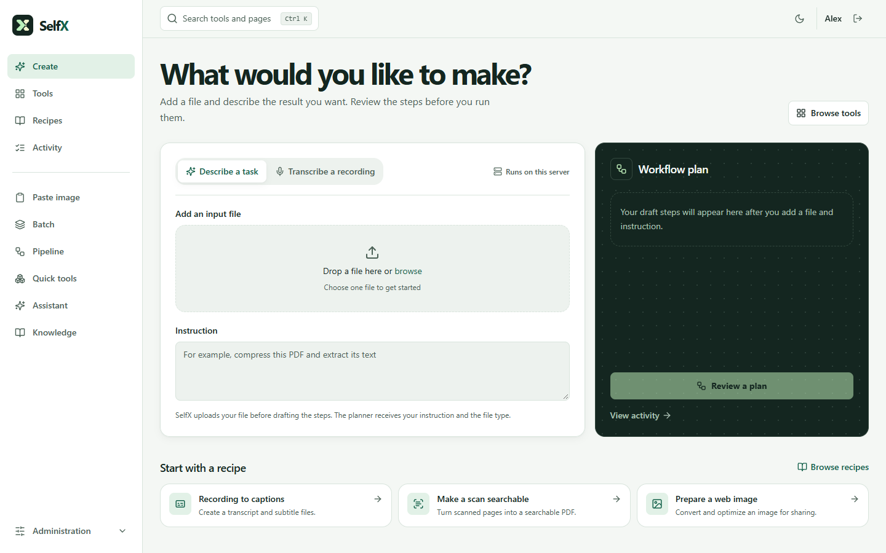

  

<h1 align="center">SelfX</h1>

<strong>A personal workspace for transforming files on your own machine.</strong>

  <a href="#quickstart">Install SelfX</a> ·
  <a href="docs/SELF_HOSTING.md">Self-hosting guide</a> ·
  <a href="deploy/vps.md">Access from a VPS</a>

Drop in a file and describe the result you want. With an optional local Qwen model, SelfX drafts a workflow from its tool catalog. Review the steps, run them, and grab the finished files from **Activity**. You can also go straight to **Tools** for a one-off job.

> Try “make this scan searchable and extract its text,” “turn this recording into a timestamped PDF and captions,” or “convert this image to WebP under 300 KB.”

## Quickstart

SelfX installs on **Ubuntu 24.04**, including **Windows with Ubuntu 24.04 in WSL2**. The installer builds the web app and sets up PostgreSQL, Redis, and separate workers for quick and heavy jobs. Manual tools, recipes, and CPU Whisper are available before you set up an AI planner.

### Ubuntu

~~~bash
git clone https://github.com/DrvDispatch/SelfX.git
cd SelfX
sudo bash deploy/install.sh --port 8800
~~~

SelfX starts automatically at boot. The installer binds to the local machine by default.

### Windows

[Set up Ubuntu 24.04 in WSL2 with systemd](docs/SELF_HOSTING.md#windows-with-wsl2), then run this from PowerShell with Git installed.

~~~powershell
git clone https://github.com/DrvDispatch/SelfX.git
Set-Location SelfX
powershell.exe -NoProfile -ExecutionPolicy Bypass -File .\deploy\setup-windows.ps1 -Port 8800
~~~

SelfX starts automatically when you sign in to Windows. You can close the terminal after setup.

### Open your workspace

Open [http://127.0.0.1:8800](http://127.0.0.1:8800) and sign in as `admin`. Retrieve your generated password with this command in Ubuntu. On Windows, open Ubuntu first with `wsl.exe -d Ubuntu-24.04`.

~~~bash
sudo sed -n 's/^SELFX_ADMIN_PASSWORD=//p' /etc/selfx/selfx.env
~~~

Use any available port in the install command and the browser URL. For a VPS, [connect through an SSH tunnel](deploy/vps.md).

## Pick your first task

| I want to… | Start here |
| --- | --- |
| Transcribe a recording and make captions | Open **Recipes → Creator captions**. Local Whisper generates timed text that you can edit and export. |
| Make a scan searchable | Open **Recipes → Searchable scan** for OCR and text extraction. |
| Reorder PDF pages or shrink a video | Open **Tools** and search for **Organize PDF pages** or **Compress video to a size limit**. |
| Reuse a workflow I described | Open **Create**, review the drafted steps, and choose **Save as recipe**. Manage, export, or import recipes in **Recipes**. |
| See what’s running | Open **Activity** to follow a workflow step by step, download results, or retry a failed step. |

Recipes you save in the browser can travel with you as JSON. Uploaded files and results are stored on your SelfX host and expire according to your retention settings.

## Add local AI

Install Ollama on the SelfX host and [enable a planner model](docs/SELF_HOSTING.md#qwen-workflow-planning). A small Qwen model at an 8K context is a practical starting point. **AI models** shows the host’s hardware and context estimates so you can choose a size to try.

The planner receives your instruction and file type. SelfX checks its proposed actions and runs the reviewed workflow through the same file tools you can use manually. Whisper runs separately and caches its models after the first download. [Configure Whisper and Qwen](docs/SELF_HOSTING.md#local-models)

## Run and extend SelfX

- [Manage services, update, and back up your data](docs/SELF_HOSTING.md)
- [Add a tool](docs/ADDING_TOOLS.md)
- [Report a bug or suggest a recipe](https://github.com/DrvDispatch/SelfX/issues/new/choose)
